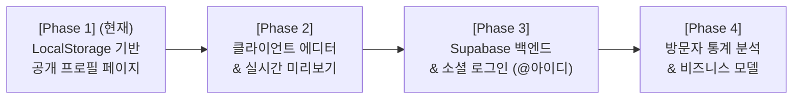
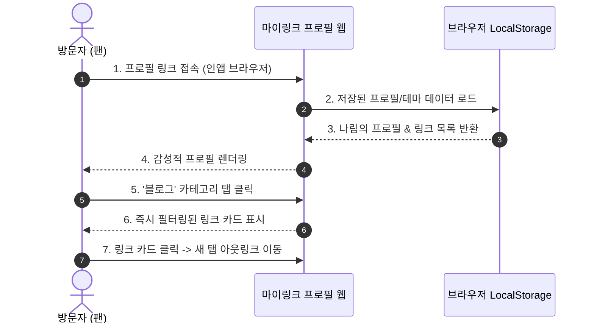

# [PRD] 마이링크 (MyLink) 제품 요구사항 정의서

- **문서 버전**: v1.4.0 (Design.md 닌텐도 하드웨어 디자인 시스템 & shadcn/ui 표준 통합)
- **작성일**: 2026-10-04
- **상태**: In-Progress (Phase 1 LocalStorage Profile Focused)
- **대상 독자**: 제품 기획자, 프론트엔드/백엔드 개발자, 시연 청중
- **참조 문서**: [Design.md](file:///c:/Users/logon/OneDrive/바탕%20화면/project/my-link-hy/Design.md) (닌텐도 하드웨어 & 웹 디자인 시스템 상세 명세서)

---

## 1. 프로젝트 개요 (Executive Summary)

### 1.1 서비스 정의
**마이링크(MyLink)**는 인스타그램, 틱톡, 유튜브 등 다양한 소셜 플랫폼에서 활동하는 **크리에이터 및 인플루언서를 위한 감성적이고 직관적인 바이오 링크(Link-in-bio) 올인원 서비스**입니다.  
단 하나의 링크로 자신의 모든 SNS 계정, 콘텐츠, 영상, 포트폴리오를 아름답게 브랜딩하여 팬들에게 공유할 수 있습니다.

### 1.2 개발 및 시연 전략 (Demonstration Strategy)
본 프로젝트는 **라이브 시연 및 점진적 빌드업(Step-by-Step)** 원칙에 따라 진행됩니다.
- 초기 복잡한 백엔드 인프라, 대시보드, 통계 시스템 구축을 지양하고, **1단계에서는 브라우저 `localStorage`를 활용하여 완성도 높은 "크리에이터 공개 프로필 페이지"를 최우선 구현 및 시연**합니다.
- 이후 단계적으로 편집 에디터, 백엔드/인증(Supabase), 통계 대시보드로 기능을 확장합니다.

---

## 2. 단계별 릴리즈 로드맵 (Staged Roadmap)



### 📌 Phase 1: 로컬 스토리지 기반 프로필 페이지 (★ 현재 시연 범위)
> **핵심 목표**: 대시보드나 백엔드 연동 없이, `localStorage` 및 초기 Mock 데이터를 기반으로 완벽히 동작하는 크리에이터 프로필 페이지 완성.

- [x] **프로필 헤더 영역**: 아바타, 이름, 한 줄 소개(Bio), 카테고리 태그, 커피챗/구직 상태 배지, 공유 버튼
- [x] **SNS 아이콘 바**: GitHub, Blog, LinkedIn, Email, Globe 등 주요 링크 원클릭 연결
- [x] **카테고리 탭 필터링**: 전체 / 포트폴리오 / 블로그 / SNS / 연락처 등 카테고리별 즉시 필터링
- [x] **스마트 링크 카드**: 링크 제목, 상세 설명, 클릭수(Mock/Local), 인기(Popular) 배지, 새 탭 링크 아웃
- [x] **링크 추가 다이얼로그 (로컬 상태)**: shadcn/ui Dialog 기반 신규 링크 등록 폼 및 `localStorage` 자동 영속화
- [x] **인터랙티브 위젯 (플레이어 폴 / 정보 박스)**: 투표 및 팬 인터랙션 모듈
- [x] **테마 커스텀 스위처**: 즉시 테마 색상(Violet, Emerald, Sky, Rose, Amber 등) 전환 및 `localStorage` 저장
- [x] **공유 모달**: 현재 URL 클립보드 복사, QR 코드 안내, 소셜 공유 트리거

### 📌 Phase 2: 클라이언트 에디터 & 실시간 미리보기
> **핵심 목표**: `Zustand` 기반의 실시간 폼 ↔ 모바일 목업 프리뷰 동기화 및 `localStorage` 저장.

- [ ] 좌측 링크/프로필 편집 폼 및 우측 모바일 실시간 프리뷰
- [ ] Drag & Drop(dnd-kit)을 활용한 링크 카드 순서 변경
- [ ] 블록 추가/수정/삭제/활성화 토글

### 📌 Phase 3: Supabase 백엔드 & 소셜 인증
> **핵심 목표**: 클라우드 DB 영구 저장 및 크리에이터별 고유 핸들(`/@username`) 지원.

- [ ] 카카오 / 구글 원클릭 소셜 로그인 (Supabase Auth)
- [ ] 고유 핸들(`/@username`) 선점 및 동적 라우팅
- [ ] PostgreSQL DB 연동 및 이미지 CDN 스토리지 연동

### 📌 Phase 4: 방문자 통계 분석 및 확장 기능
> **핵심 목표**: 크리에이터 성장 지원 및 비즈니스 모델(BM).

- [ ] 대시보드 통계 차트 (PV/UV, 링크별 CTR, 유입 경로 레퍼러 분석)
- [ ] 커스텀 독립 도메인 연결 (`links.mybrand.com`)
- [ ] Pro 유료 구독 모델 (워터마크 제거, 고급 애니메이션)

---

## 3. 타깃 페르소나 및 사용자 시나리오 (User Scenarios)

### 3.1 타깃 페르소나 (Personas)

| 구분 | 1인 크리에이터 / 개발자 (박나림, 26세) | 팬 및 일반 방문자 (이수현, 22세) | IT 기업 채용 담당자 (김민석, 34세) |
| :--- | :--- | :--- | :--- |
| **역할** | 프로필 페이지의 소유자 / 콘텐츠 공급자 | SNS를 통해 유입된 팬 및 콘텐츠 소비자 | 인재 영입 및 협업을 위해 검토하는 비즈니스 유저 |
| **목적** | 깃허브, 블로그, 포트폴리오를 한곳에 예쁘게 정리하여 공유 | 좋아하는 크리에이터의 최신 소식 및 링크 확인 | 지원자의 작업물, 기술 블로그, 커피챗 가능 여부 파악 |
| **주요 디바이스** | 데스크톱 / 노트북, 모바일 | 스마트폰 (인스타그램 인앱 브라우저) | 데스크톱 PC |

---

### 3.2 상세 사용자 시나리오

#### 📱 시나리오 1: [방문자/팬] 인스타그램 프로필 링크를 통한 유입 및 탐색 (Phase 1 시연 핵심)
1. **유입 (Entry)**: 수현은 인스타그램을 보다가 프로필 소개글에 있는 `마이링크` 주소를 탭합니다.
2. **첫인상 (First View)**: 로딩 지연 없이 0.5초 만에 나림의 프로필 아바타, "새로운 기회와 커피챗 환영" 상태 배지, 감각적인 테마 색상이 한눈에 펼쳐집니다.
3. **카테고리 탐색 (Filtering)**: 수현은 나림의 글을 읽고 싶어 **[블로그]** 카테고리 탭을 누릅니다. 페이지 새로고침 없이 즉시 기술 블로그 링크만 필터링됩니다.
4. **콘텐츠 소비 (Outlink)**: `[POPULAR]` 배지가 붙어 있는 '기술 블로그' 카드를 클릭하여 새 탭에서 블로그 글을 읽습니다.
5. **팬 인터랙션 & 공유 (Engagement)**: 다시 마이링크 탭으로 돌아와 우측 **'Player's Poll'** 투표에 참여하고, 상단 **[공유하기]** 버튼을 눌러 친구에게 줄 링크를 클립보드에 복사합니다.



---

#### 🎨 시나리오 2: [크리에이터] 실시간 테마 스위칭 및 브랜딩 커스텀 (Phase 1 시연 핵심)
1. **테마 변경 (Theming)**: 나림은 오늘의 기분이나 브랜딩 톤에 맞춰 프로필 페이지의 분위기를 바꾸고 싶어합니다.
2. **색상 선택**: 우측 패널의 **'Chassis Display Mode'**에서 `Violet`, `Emerald`, `Sky`, `Rose`, `Amber` 버튼을 눌러봅니다.
3. **실시간 반영 (Instant Feedback)**: 버튼을 누르는 순간 헤더 배지, 링크 카드의 호버 테두리, 버튼 컬러가 즉시 전환됩니다.
4. **로컬 스토리지 동기화 (Persistence)**: 선택된 테마는 `localStorage`에 자동 저장되어, 브라우저를 새로고침하거나 다시 접속해도 내가 선택한 테마가 유지됩니다.

---

#### 💼 시나리오 3: [채용 담당자/협업자] 포트폴리오 검토 및 커피챗 신청
1. **프로필 탐색**: 채용 담당자 민석은 이력서에 기재된 마이링크 주소로 접속합니다.
2. **구직 상태 확인**: 상단에 초록색 불빛과 함께 **'Available for Hire'** 및 **'새로운 기회와 커피챗 언제나 환영합니다 ☕'** 문구를 확인하고 안심합니다.
3. **포트폴리오 카테고리 확인**: **[포트폴리오]** 탭을 눌러 GitHub 저장소와 개인 인터랙티브 웹사이트를 차례로 열어 코드를 확인합니다.
4. **연락처 연결**: **[연락처]** 탭의 '연락 및 커피챗 신청 (Email)' 카드를 클릭하여 곧바로 이메일 작성 창을 띄워 커피챗을 제안합니다.

---

#### 🛠️ 시나리오 4: [크리에이터] 링크 관리 및 실시간 에디터 편집 (Phase 2 연계 시나리오)
1. **에디터 진입**: 크리에이터가 관리자 페이지(`/admin`)에 접속합니다.
2. **링크 추가/수정**: 새로운 유튜브 영상 링크를 입력하고 썸네일을 등록합니다.
3. **드래그 앤 드롭 정렬**: 새로 올린 유튜브 영상을 가장 위로 끌어올립니다(Drag & Drop).
4. **실시간 프리뷰 확인**: 우측의 스마트폰 목업 화면에서 내가 수정한 링크가 1초의 딜레이도 없이 그대로 반영되는 것을 확인한 후 저장합니다.

---

## 4. Phase 1 프로필 페이지 상세 기능 요구사항

### 4.1 로컬 스토리지 데이터 스키마 (LocalStorage Schema)
```typescript
// 'mylink_profile_data' 키로 로컬 스토리지에 저장/불러오기
export interface UserProfile {
  id: string;
  username: string;
  displayName: string;
  bio?: string;
  avatarUrl?: string;
  tags?: string[];
  statusMessage?: string;
  isAvailableForHire?: boolean;
  stats?: {
    views: number;
    likes: number;
  };
  links: LinkItem[];
}

export interface LinkItem {
  id: string;
  title: string;
  url: string;
  description?: string;
  icon?: string;
  category?: string;
  isActive?: boolean;
  clickCount?: number;
  isPopular?: boolean;
}

export type ThemeAccent = "violet" | "emerald" | "sky" | "rose" | "amber";
```

### 4.2 사용자 인터랙션 명세
1. **초기 로딩**: `localStorage`에 저장된 프로필/테마가 있으면 불러오고, 없으면 `INITIAL_PROFILE` 기본값으로 자동 초기화.
2. **테마 변경**: 우측 또는 상단 테마 스위처를 누르면 즉시 전체 팔레트가 변경되며 `localStorage`에 동기화.
3. **카테고리 필터**: 탭 클릭 시 리렌더링 없이 즉시 해당 카테고리의 링크만 필터링 표시.
4. **링크 클릭 시**: 새 창으로 안전하게 외부 링크 오픈(`rel="noopener noreferrer"`).
5. **공유 모달**: '공유하기' 버튼 클릭 시 현재 페이지 주소 복사 알림 및 토스트 피드백 제공.

### 4.3 시연 및 개발용 표준 더미 데이터 (Mock Dummy Data)
Phase 1 로컬 시연 및 테스트에 사용되는 기본 프로필(`INITIAL_PROFILE`) 및 링크 더미 데이터(`src/constants/index.ts`)는 실제 개발자/크리에이터의 실감나는 포트폴리오 구성을 반영합니다.

- **기본 프로필**: 박나림 (프론트엔드 개발자, Next.js & UI/UX)
- **분류 카테고리**: `전체`, `개발/코드`, `포트폴리오`, `블로그`, `SNS`, `연락처`
- **지원 아이콘**: `github`, `project`, `blog`, `resume`, `code`, `linkedin`, `youtube`, `twitter`, `mail`, `send`, `globe`
- **포함 데이터 항목**:
  1. **[개발/코드]** GitHub & 프로젝트 저장소 (`github`, HOT 인기 배지)
  2. **[포트폴리오]** 인터랙티브 3D 웹 포트폴리오 2026 (`project`, HOT 인기 배지)
  3. **[블로그]** 기술 블로그 (Tech Insights - 성능 최적화 & 트러블슈팅) (`blog`, HOT 인기 배지)
  4. **[포트폴리오]** Notion 상세 이력서 & 경력기술서 (`resume`)
  5. **[개발/코드]** 디자인 시스템 컴포넌트 갤러리 - Storybook (`code`)
  6. **[SNS]** LinkedIn 커리어 & 비즈니스 네트워킹 (`linkedin`)
  7. **[SNS]** YouTube 코딩 & 프론트엔드 VLOG (`youtube`)
  8. **[SNS]** X (Twitter) 실시간 기술 트렌드 소통 (`twitter`)
  9. **[연락처]** 1:1 커피챗 & 멘토링 예약 - Calendly (`mail`, HOT 인기 배지)
  10. **[연락처]** 채용 및 비즈니스 협업 공식 이메일 (`send`)
- **확장 프리셋**: `DUMMY_LINK_PRESETS`를 통해 프론트엔드 개발자(`frontendDeveloper`) 및 UI/UX 디자이너/크리에이터(`designerCreator`) 프리셋 데이터셋을 제공하여 다양한 시연 시나리오 지원.

---

## 5. 정보 구조도 (Phase 1 기준)

```
[마이링크 (MyLink) Phase 1]
 └── 공개 프로필 페이지 (/)
      ├── [상단] 헤더 & 브랜드 로고
      ├── [본문 좌측] 프로필 헤더 (아바타, 소개, 태그) + 카테고리 탭 + 링크 카드 목록
      ├── [본문 우측] 테마 모드 스위처 + 서비스 소개 카드 + 인터랙티브 투표 모듈
      ├── [공통] 프로필 공유 모달
      └── [하단] 푸터 및 브랜딩
```

---

## 6. 기술 스택 및 디자인 시스템 (Tech Stack & Design System)

### 6.1 기술 스택

| 계층 | 기술 스택 | 적용 목적 |
| :--- | :--- | :--- |
| **Framework** | **Next.js 16 (App Router)** | 서버 컴포넌트 및 클라이언트 하이브리드 아키텍처, 초고속 렌더링 |
| **UI Components** | **shadcn/ui (@radix-ui / @base-ui)** | 접근성과 재사용성을 보장하는 모던 UI 프리셋 기반 재사용 컴포넌트 시스템 |
| **Styling** | **Tailwind CSS v4 (100% 통일)** | **모듈 CSS 배제**, CSS-first 테마 변수, 유틸리티 클래스 및 반응형 레이아웃 일원화 |
| **Design System** | **2001 Nintendo Hardware Hub Style** | [Design.md](file:///c:/Users/logon/OneDrive/바탕%20화면/project/my-link-hy/Design.md)에 정의된 레트로 하드웨어 섀시, 베벨 및 실크스크린 라벨 시스템 |
| **Icons** | **Lucide React** | 직관적이고 경량화된 UI 아이콘 세트 |
| **Data Persistence** | **Browser LocalStorage** | 시연을 위한 무(無)서버 클라이언트 데이터 영속화 |
| **Form & Validation** | **React Hook Form (RHF) + Zod** | 스키마 기반 실시간 폼 유효성 검증 및 타입 안전성 보장 |
| **State Management** | **React State / Zustand** | 테마 전환, 카테고리 필터링, 모달 상태 제어 |
| **Language** | **TypeScript 5** | 엄격한 타입 안정성 보장 |

---

### 6.2 디자인 시스템 및 스타일링 표준 원칙 (Tailwind CSS 단일화 & shadcn/ui 재사용 아키텍처)

본 프로젝트의 모든 UI 디자인 및 화면 인터페이스는 **모듈 CSS(`*.module.css`) 사용을 배제하고 Tailwind CSS v4 유틸리티 클래스로 100% 통일**하며, 모든 페이지 요소는 **`src/components/ui/` 내 shadcn/ui 기반 컴포넌트를 조립하여 재사용**하도록 설계합니다.

#### 1. 스타일링 일원화 원칙 (Tailwind CSS Unified Styling)
- **모듈 CSS 완전 배제**: 별도의 `*.module.css` 파일을 생성하거나 불러오지 않으며, 모든 레이아웃, 간격, 타이포그래피, 반응형 처리는 Tailwind CSS 유틸리티 클래스로 통일합니다.
- **글로벌 토큰 일원화**: 베벨 효과(`.nintendo-plate`, `.nintendo-inset`, `.nintendo-chip`), 텍스트 스타일(`.nintendo-boxart-text`), 하프톤 패턴(`.bg-carbon-halftone`) 등은 `src/app/globals.css`의 글로벌 유틸리티 클래스로 관리하여 모든 컴포넌트에서 일관되게 재사용합니다.

#### 2. shadcn/ui 재사용 컴포넌트 아키텍처
모든 기능 페이지(프로필, 링크 목록, 에디터 등)는 아래의 재사용 가능한 shadcn/ui 컴포넌트 세트를 기반으로 구축합니다:

- **`Button` (`src/components/ui/button.tsx`)**:
  - `nintendoOrange` (기본 시그널 액션), `nintendoRed` (시그니처 레드), `nintendoCarbon` (다크 칩), `nintendoGold` (엠버 칩), `nintendoPlate` (메탈 칩), `nintendoInset` 등 물리 버튼 변형 제공.
- **`Card` (`src/components/ui/card.tsx`)**:
  - `default`/`plate` (Level 1 Plate), `whitePlate`, `inset` (Level 0 Inset), `darkInset`, `carbon` (스피커 그릴 패턴) 등 하드웨어 섀시 패널 지원.
- **`Badge` (`src/components/ui/badge.tsx`)**:
  - `nintendoRed` (HOT 인기 배지), `nintendoOrange`, `nintendoGold`, `nintendoCarbon`, `nintendoOnline` (LED 점멸 상태등) 등 실크스크린 라벨 배지 제공.
- **`Avatar` (`src/components/ui/avatar.tsx`)**:
  - Radix Primitives 기반 `Avatar`, `AvatarImage`, `AvatarFallback`을 하드웨어 프레임과 결합하여 프로필 이미지로 재사용.
- **`Tabs` (`src/components/ui/tabs.tsx`)**:
  - 하드웨어 카트리지/스위치 탭 인터랙션 지원.
- **`Dialog` (`src/components/ui/dialog.tsx`)**:
  - 카본 헤더 바와 메탈릭 플레이트 베벨 섀시가 결합된 모달 팝업.
- **`RadioGroup` / `Separator`**:
  - 닌텐도 하드웨어 토글 및 2단 음각 그루브 라인 지원.

#### 3. 3단계 베벨 깊이 계층 구조 (Depth Hierarchy)
- **Level 0 (Inset/Recessed — `.nintendo-inset`)**: 슬롯, 아바타 프레임, 스피커 그릴 등 인셋 컨테이너에 적용.
- **Level 1 (Plate/Chassis — `.nintendo-plate`)**: 기본 콘텐츠 카드, 프로필 헤더 베이스, 메탈 바에 적용.
- **Level 2 (Chip/Raised — `.nintendo-chip`)**: 클릭 가능한 물리 버튼 및 탭 스위치에 적용. `:active` 시 역베벨로 실제 버튼이 눌리는 물리 피드백 제공.

#### 4. 접근성(a11y) 및 CSS-first 테마 연동
- 모든 컴포넌트는 Radix Primitives의 WAI-ARIA 접근성 및 키보드 조작 표준을 준수합니다.
- `src/app/globals.css`의 CSS 변수(`--canvas`, `--periwinkle`, `--carbon`, `--primary-red`, `--signal-orange` 등)와 Tailwind v4 테마 토큰을 100% 동기화하여 실시간 테마 스위칭을 지원합니다.

---

## 7. 비기능적 요구사항

1. **스타일 일관성 & 모듈 CSS 배제**: 프로젝트 전반에 걸쳐 Tailwind CSS 및 shadcn/ui 컴포넌트 표준을 100% 준수하여 유지보수성과 컴포넌트 재사용성 극대화.
2. **무결성 및 폴백 (Graceful Degradation)**: `localStorage`가 비어있거나 손상되었을 때 항상 기본 Mock 프로필(`INITIAL_PROFILE`)로 안전하게 렌더링.
3. **모바일/데스크톱 완벽 반응형**: 1열 모바일 뷰와 2열 데스크톱 뷰를 매끄럽게 지원.
4. **시연 편의성**: 별도의 백엔드 서버나 DB 셋업 없이 `npm run dev`만으로 브라우저에서 즉시 모든 프로필 기능 시연 가능.

